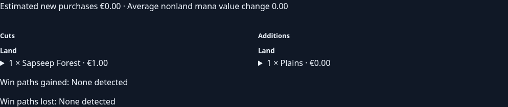

# CommanderOracle

Build, analyze and upgrade single-commander Magic decks locally. Generate a deck for a bracket and euro budget, import a list you already play, or search the bundled Commander precons. The Architect explains how the deck can win and which pieces or prerequisites are missing.

## Run the app

1. Install Node.js 22 or newer and extract the ZIP into a folder. When updating, copy your existing `data/` folder into the new installation to keep your catalog, research and deck library.
2. On Windows, double-click `start-windows.bat`. On other systems, run `npm start` and open [the local app](http://127.0.0.1:4285).
3. Under **Scryfall catalog**, click **Update database** and wait for the card count. A fresh installation needs internet for this download. Local deck review uses the installed catalog. The optional connected Architect has its own sign-in flow.

## Save and compare decks

Open **Deck library & practice** from the deckbuilder or use **Open in deck library** on a result. Save a starting list with an upgrade allowance. Open that version later, change cards, and save a branch. Each branch tracks its own spending, bracket and locks. Reopen any earlier version to try another route.

Compare the working deck with a saved version to see cuts, additions, recognized roles, changes in win paths and the estimated purchase cost. Export in Archidekt or Moxfield text format. In **Practice opening hands**, keep or mulligan, choose which cards to bottom, and choose lands and supported first casts through turn four. Replay a seed on a second version to compare the draws.

## Prices and bracket review

Under **My collection**, import or paste CSV with `Name`, `Quantity`, and optional `Reserved` columns. Quote names containing commas. Duplicate rows are summed. Enable collection credits to use available inventory in local generation, Architect pricing, ranked search and upgrade passes. The library calculates purchases by copy. Construction conservatively credits repeatable cards when enough copies are available to cover the maximum selectable quantity. Basic-land ownership is separately configurable.

**Check bracket & purchase cost** shows the dated catalog flags, matched infinite combos and the app’s local policy for the chosen bracket. Preview a swap to see its price and changes in win paths before applying it. The practice simulator models a subset of Magic rules. A supported cast or a complete card inventory does not establish a winning turn.

## Development

- `npm test` runs the fast group. `npm run test:slow` runs the heavier generation cases. `npm run test:all` runs both.
- Local clients obtain a session token with `GET /api/session` and send its `csrf` value in the `x-commander-ai-session` header on every POST. Tokens expire on server restart.
- [Architect guide](docs/CHATGPT_ARCHITECT.md) · [Upgrader guide](docs/EXPERIMENTAL_UPGRADER.md) · [Roadmap](docs/ROADMAP.md) · [Changelog](CHANGELOG.md)
- [Earlier setup notes, benchmark reports and version history](docs/PROJECT_HISTORY.md) · [User-reported external ratings](benchmarks/external-ratings.csv)
